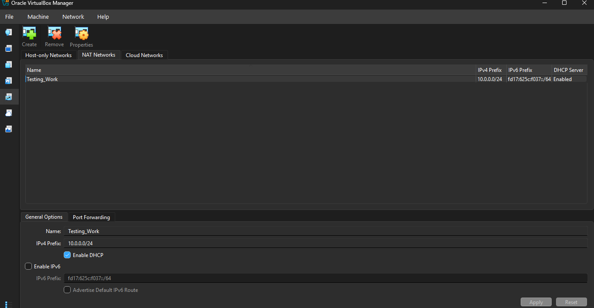

# NETWORKWALKS-B084-WK1-PM1-CYBERSECURITY-LAB-SETUP
Dedicated virtual security testing lab built on Oracle VirtualBox using Kali Linux and custom NAT networking for penetration testing and vulnerability analysis.
# 🛡️ Virtual Security Testing & Penetration Testing Lab Setup

A secure, isolated virtualization lab deployed using Oracle VirtualBox and Kali Linux, designed for hands-on practice in penetration testing, vulnerability assessment, and offensive security methodologies.

---

## 📌 Executive Summary

The primary objective of this project is to build an isolated, reproducible virtual laboratory for hands-on cybersecurity research and security audits. By sandboxing the environment, essential penetration testing workflows—such as reconnaissance, network scanning, vulnerability identification, and traffic analysis—can be conducted reliably without exposing production infrastructure or violating authorized parameters.

The architecture utilizes a dedicated **NAT Network** segment to host both the attacker machine (Kali Linux) and future target systems under a single private IPv4 subnet, ensuring secure intra-lab communication while preserving external connectivity for software updates.

---

## 🎯 Key Objectives

- Deploy and harden the **Oracle VirtualBox** hypervisor on a Windows 11 host.
- Provision and configure a specialized **Kali Linux** virtual appliance.
- Create an isolated **NAT Network** architecture to facilitate multi-target engagements.
- Implement a static IP allocation schema (IP, Netmask, Gateway, DNS) for deterministic host auditing.
- Validate internal routing, outbound traffic reachability, and DNS resolution pipelines.
- Generate pristine baseline recovery snapshots to enable rapid sandbox recovery.
- Systematically document deployment steps, architectural choices, and technical resolutions.

---

## 🔬 Practical Scope & Capabilities

This isolated testing laboratory supports standard defensive and offensive security workflows, including:

- Host discovery and active network reconnaissance (Nmap).
- Port enumeration and service fingerprinting.
- Network packet inspection and protocol analysis (Wireshark).
- Web application security auditing and manual vulnerability exploitation.
- Exploitation framework evaluations (Metasploit Framework).
- Safe evaluation of custom tooling and automation scripts.


> ⚠️ **Legal & Ethical Notice:** This lab environment is strictly intended for educational and authorized defensive/offensive assessment workflows. Interacting with, scanning, or exploiting networks or infrastructure without prior explicit written authorization is illegal.

---

## ⚙️ Hardware & Lab Specifications

| Parameter | Technical Configuration |
| :--- | :--- |
| **Host Operating System** | Windows 11 Pro / Home (64-bit) |
| **Host Hardware Platform** | AMD Ryzen 5 Series / 8 GB System RAM |
| **Hypervisor Software** | Oracle VM VirtualBox 7.x |
| **Guest Security Distribution** | Kali Linux (Pre-configured Virtual Appliance) |
| **Guest Memory Allocation** | 2048 MB (2 GB vRAM) |
| **Virtual Network Topology** | Dedicated VirtualBox NAT Network (`NatNetwork`) |
| **Private Subnet CIDR** | `10.0.0.0/24` |
| **Kali Static Interface** | `10.0.0.2/24` |
| **Default Router / Gateway** | `10.0.0.1` |
| **Primary Domain Resolver** | `8.8.8.8` (Google Public DNS) |
| **Target Machine Scope** | `10.0.0.3` – `10.0.0.99` (DHCP / Static Scope) |

---

## 🪜 Setup & Deployment Procedure

### Step 1: Toolchain Installation
Installed **7-Zip** on the host environment to reliably decompress high-ratio archives (`.7z`) containing virtual disk images and base appliance templates.

### Step 2: Hypervisor Configuration
Installed and initialized **Oracle VirtualBox** on the Windows 11 host, confirming compatibility with underlying host hardware virtualization layers.

### Step 3: Segmented NAT Network Provisioning
Configured a private, multi-VM software-defined network within VirtualBox Global Tools:
- **Network Identifier:** `NatNetwork`
- **IPv4 Network Prefix:** `10.0.0.0/24`
- **DHCP Service:** Enabled (for automated target provisioning)
- **IPv6 Support:** Disabled



*Design Rationale:* Standard VirtualBox NAT limits communication strictly between the host and single guests. A **NAT Network** functions as a virtual switch, enabling multiple virtual machines to communicate directly while sharing an outbound NAT path to the internet.

### Step 4: Kali VM Provisioning & Hardware Tuning
Imported the official Kali Linux virtual appliance and adjusted interface parameters:
- **Network Mode:** Attached to `NAT Network` (`NatNetwork`)
- **Virtual Network Adapter:** Intel PRO/1000 MT Desktop
- **Assigned vRAM:** 2048 MB
- **Shared Storage:** Created a bi-directional shared directory between Windows 11 and Kali Linux for secure transfer of payloads, scripts, and logs.

### Step 5: Static Addressing & Interface Hardening
Assigned a deterministic static IPv4 configuration to the primary network adapter to ensure reliable cross-VM communication:
- **IPv4 Address:** `10.0.0.2`
- **Subnet Mask:** `255.255.255.0`
- **Default Gateway:** `10.0.0.1`
- **Primary DNS:** `8.8.8.8`

### Step 6: Pristine Baseline Snapshot Generation
Created an initial system snapshot directly after network validation:
- **Snapshot Label:** `Baseline - Clean Network Setup`
- **Purpose:** Establishes an immutable recovery checkpoint. In the event of system corruption or package failure during intensive testing, the sandbox can be reverted in seconds.

---

## 🔎 Post-Configuration Verification

| Test Target | CLI Command | Expected Result | Operational Status |
| :--- | :--- | :--- | :--- |
| **Interface Binding** | `ip a show eth0` | Static IPv4 `10.0.0.2/24` properly bound | Verified ✅ |
| **Local Gateway Routing** | `ping -c 4 10.0.0.1` | 0% packet loss to virtual router | Verified ✅ |
| **Outbound IP Connectivity** | `ping -c 4 8.8.8.8` | Stable ICMP ping responses from external IP | Verified ✅ |
| **Domain Name Resolution** | `nslookup google.com` | Correct DNS records resolved via nameserver | Verified ✅ |
| **Core Utility Execution** | `nmap --version` | Valid tool execution and binary response | Verified ✅ |
| **System Rollback Test** | Snapshot Restoration | Restores clean system state and network bindings | Verified ✅ |

---

## 🐞 Challenges Encountered & Technical Resolutions

### Challenge 1: Outbound Routing Loss Post Static IP Assignment
- **Issue:** Following manual static IP configuration, external network access dropped despite valid routing tables.
- **Root Cause:** NetworkManager failed to bind default routes correctly due to Duplicate Address Detection (DAD) timeouts on the interface.
- **Resolution:** Modified connection properties via `nmcli` to disable DAD timeouts and refreshed the interface:
  ```bash
  sudo nmcli connection modify "Wired connection 1" ipv4.dad-timeout 0
  sudo nmcli connection up "Wired connection 1"
Challenge 2: AMD-V Hardware Virtualization Fault in Hypervisor
Issue: VirtualBox blocked VM launch with a hardware virtualization error: "AMD-V is disabled in the BIOS (or host OS does not support it)".

Root Cause: Hardware virtualization extensions were disabled by default within the AMD Ryzen motherboard UEFI settings.

Resolution: Rebooted the Windows 11 host into UEFI/BIOS, navigated to Advanced CPU Configuration / OC Tweaker, enabled SVM Mode (Secure Virtual Machine / AMD-V), saved configurations, and resumed boot. The Kali VM initialized without further errors.

💡 Key Architectural Insights
Software-Defined Virtual Switching: Utilizing a NAT Network provides the exact blend of containment and utility required for offensive labs—isolating malicious payloads from the host while permitting realistic multi-node network interaction.

Deterministic Infrastructure: Static IP assignments across testing hosts simplify documentation, ensure consistent automated scripting, and eliminate fluctuating target addresses.

Snapshot-Driven Workflows: In penetration testing environments, systems are designed to break. Maintaining versioned baseline snapshots ensures low-friction rollback following intensive binary testing or system modifications.

🔗 Reference Toolchain
Oracle VM VirtualBox: virtualbox.org

Kali Linux Open-Source Platform: kali.org

7-Zip Archive Utility: 7-zip.org
